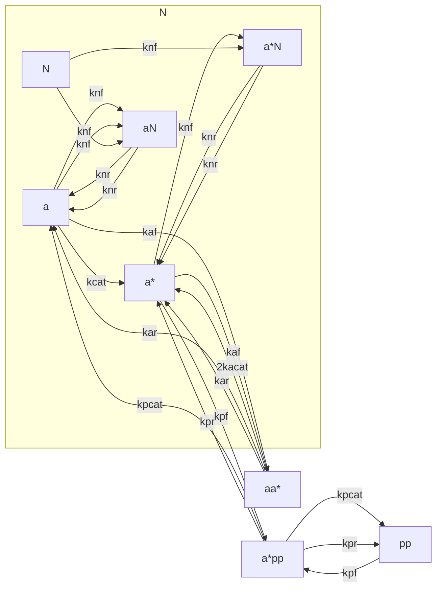
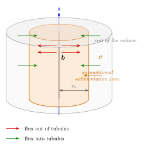

# aurSingTube
single tube aurora diffusion and kynetics simulation

Requirements:

- python vtk (conda install vtk is normally ok)
- Paraview (tar.gz version without installation required from [https://www.paraview.org/download/](# https://www.paraview.org/download/) is ok for Linux )
- scipy (version >=1.8.0, sparse dia_matrix-> dia_array)

Shall probably remove the previous from here and put it into the req.txt file .

## General background

This is an attempt to build an approximation for a system of partial differential equations representing aurora-kynase interactions with mitotic spindle microtubules inside living cell cytoplasma.  We consider a single microtubule with several species of ferments on it and in surrounding cytoplasma, thus forming a kind of axially symmetric environment, in which all the transportation and chemical reactions are assumed to be modelled by reaction-diffusion equations. That is, the key assumptions are as follows :
 - perfect ergodicity
 - molecular dynamics effects are negligeable , thus species flows from and onto the micotubule are assumed to be continuous

## The problem , for which approximation is built 

The details are given in the notes folder. The main schemes are as follows. 

# In the Volume

# On the Tubulus 

To concider the interaction between the tubulus and the volume we are to introduce the notion of the unconditional sedimentation radius $r_0$, i.e. the radius of the zone inside which the absorbtion of a molecule by the tubulus becomes inevitable. 

Once we aet it forth we can write the substance flow from the volume towards the tubulus as 

$$
f_+ = \int_0^{r_0} 2\pi r k_+ cdr  = \pi r_0^2 k_+ c
$$

The flow from tubulus to the volume then reads as 

$$
f_- = k_- b 
$$

Then the whole time variable of the linear concentration by time reads as 

$$
\frac {\partial b}{\partial t} = f_+ - f_- = \pi r_0^2 k_+ c - k_- b
$$

where the dimensionality of $k_+$ and $k_-$  is $t^{-1}$

At the same time , the amount of substance dissolving from/sedimenting on the tubulus exactly equals to the change in the same substance in the surrounding solution at r=0 (we treat $r_0$ to be negligibly small for now). 

$$
\frac {dN}{dt} = \int_S J ds  ,\ J = -D \frac {dc}{dr}
$$

with $S$ being treated as area through which the flow is considered. The minus sign is necessary so far the substance is flowing towards the lower concentration. 

# Approximate Constant Values 

| designation | value | source | comment |
| --- | --- | --- |--- |
|  |  |  | |
| a | 8 mcM | [1] | |
| N | 8 mcM | [1] | maximal receptor rate , those , connected with aurora-kynase |
| pp | 0.4 mcM | [1]  | |
| | | | |
| kcis | $$7.3 *10^{-4}\ : 7.3$$ | [1] | |
| kcat | $$19\ s^{-1}$$ | [1] | | 
| kpcat | $$0.024\ s^{-1}$$ | [1] | |
| kaf | $$0.1\ mcM^{-1}s^{-1}$$ | | |
| kar | | | made of other constants |
| knf | $$50\ mcM^{-1}s^{-1}$$ | | |
| knr | $$1600\ s^{-1}$$ | | |
| kacat | $$0.027\ s^{-1}$$ | | |
| kpf | $$0.6\ mcM^{-1}s^{-1}$$ | | |
| kpr | $$0.4 * 10^{-3}\ s^{-1}$$ | | |

| designation | measure unit | dimensionless value | comment |
| --- | --- | --- | --- |
| kcat | kcis/kpcat , time scale | $$3.84 * 10^{-5}$$ | |
| kpcat | kcat | 1 | |
| kaf | kcat/ a0 | 21 | |
| kar | kcat | 3.36 | |
| knf | kcat/a0 | 21 | |
| knr | kcat | 842 | |
| kacat | kcat | 0.0014 | |
| kpf | $$0.6mcM^{-1}s^{-1} kcat/pp0 $$ | 0.0013 | |
| kpr | kcat | 0.06 | |

References

[1](https://elifesciences.org/articles/10644)
[2](https://www.nature.com/articles/s41467-019-08418-4)

## Approximation

We have thus a system of equations of the following kind

$$
\partial_t u = D \Delta u + f(u) , 0<=r <=R , 0<=z <= H 
$$ 

where $ u = u(r,z) $ is the vector of spacial densities of species. 

$$
\partial_t s = c \Delta s + g(s) + h(u) , 0<= z <= H/2
$$

where $ s = s(z) $ is a vector of linear densities of species on the surface of a tubule. 

