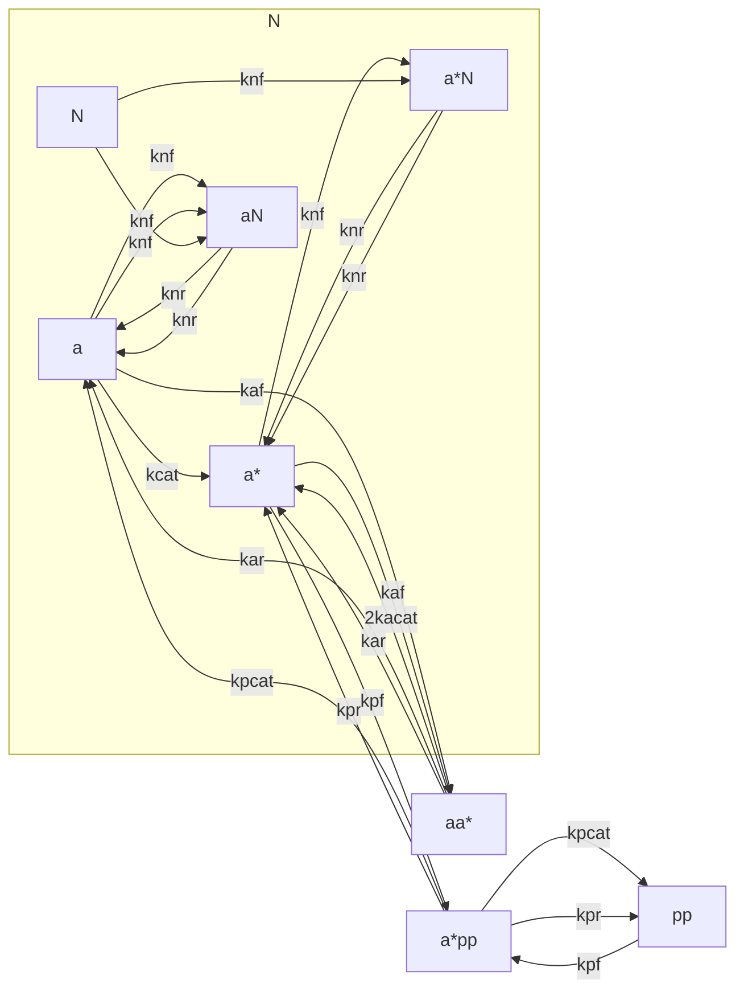

# aurSingTube
single tube aurora diffusion and kynetics simulation

Requirements:

- python vtk (conda install vtk is normally ok)
- Paraview (tar.gz version without installation required from [https://www.paraview.org/download/](# https://www.paraview.org/download/) is ok for Linux )
- scipy (version >=1.8.0, sparse dia_matrix-> dia_array)

Shall probably remove the previous from here and put it into the req.txt file .

## General background

This is an attempt to build an approximation for a system of partial differential equations representing aurora-kynase interactions with mitotic spindle microtubules inside living cell cytoplasma.  We consider a single microtubule with several species of ferments on it and in surrounding cytoplasma, thus forming a kind of axially symmetric environment, in which all the transportation and chemical reactions are assumed to be modelled by reaction-diffusion equations. That is, the key assumptions are as follows :
 - perfect ergodicity
 - molecular dynamics effects are negligeable , thus species flows from and onto the micotubule are assumed to be continuous

## The problem , for which approximation is built 

The details are given in the notes folder. The main schemes are as follows. 

# In the Volume

# On the Tubulus 

# Approximate Constant Values 

| sign | meaning | value |
| --- | --- | --- |
|  |  |  |
| git diff | Show file differences that haven't been staged | |

## Approximation

We have thus a system of equations of the following kind

$$
\partial_t u = D \Delta u + f(u) , 0<=r <=R , 0<=z <= H 
$$ 

where $ u = u(r,z) $ is the vector of spacial densities of species. 

$$
\partial_t s = c \Delta s + g(s) + h(u) , 0<= z <= H/2
$$

where $ s = s(z) $ is a vector of linear densities of species on the surface of a tubule. 

